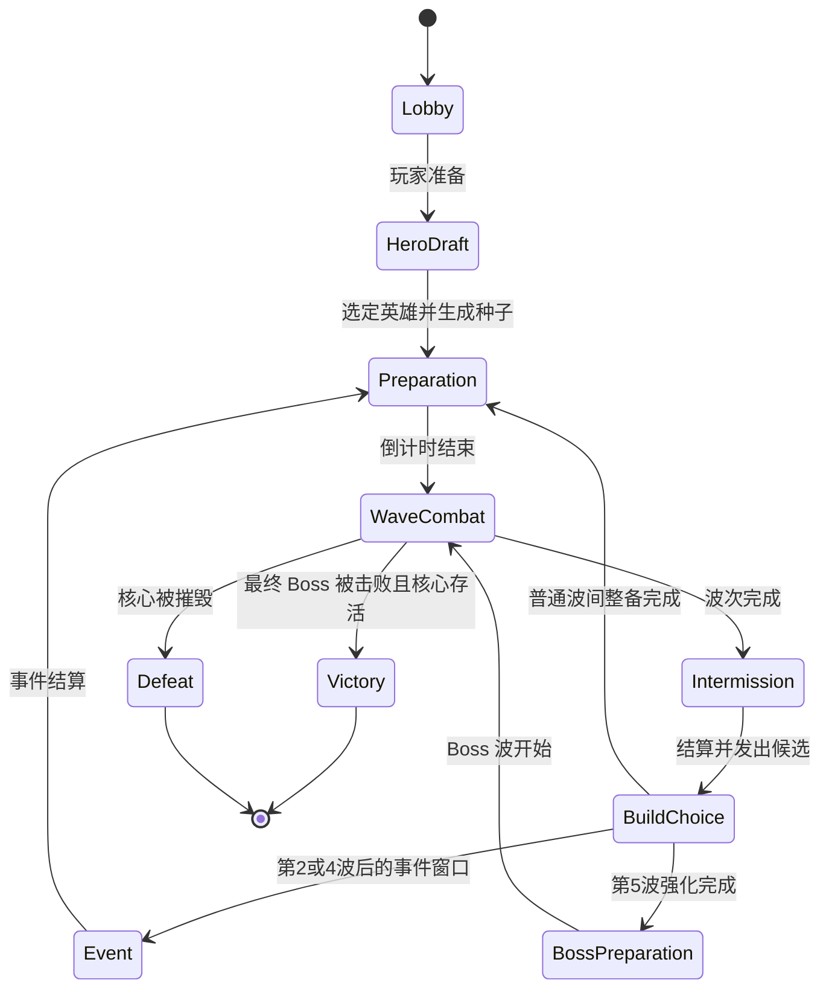

# 肉鸽成长型合作防守 RPG 设计

> 项目代号：Aegis Defense（暂名）
> 文档状态：完整设计提案；DEF-002 Phase 1 已实现并通过用户验收，进入 Phase 2
> 版本：0.5 · 2026-10-15 · 全部数值为原型调优起点
> 适用基线：Unreal Engine 5.8、Combat 单 Runtime Module、`combat_v4_economy_rc1`
> 关联任务：[DEF-001 Spec](../Specs/DEF-001-coop-defense-design.spec.md)

这是一款 1–4 人合作、单人也能完成一局的顶视角防守 RPG。玩家操控各自的英雄，在守护核心的同时离开基地清理敌人、完成事件、购买装备，并在每个阶段从随机强化中构筑本局玩法。波次负责制造倒计时和回防压力，肉鸽选择负责让每局形成不同的战斗方式。

首版采用“每局随机、局内成长、局外不养成”的边界。玩家在一局中获得的强化、装备和事件奖励只服务当前对局；账号级天赋、跨局数值和长线存档以后单独评审。这样可以先验证选择是否有趣，再决定是否需要长期成长。

## 1. 体验目标与设计支柱

### 1.1 核心体验

玩家应该经常遇到这样的决定：

- 现在回城修整，还是再深入一片区域拿一份高风险强化？
- 选择稳定的生存强化，还是押注可以滚雪球的输出组合？
- 队伍把金币花在个人装备，还是立即购买一件团队消耗品？
- 当前波次快结束时，是清理最后一组敌人拿奖励，还是立刻回防核心？

这些选择必须改变下一阶段的行为，而不是只把数字提高一点。

### 1.2 五个支柱

| 支柱 | 设计要求 | 可观察结果 |
| --- | --- | --- |
| 回防压力 | 核心持续受到来自多条路线的威胁 | 离家越久，警报和路线压力越高 |
| 构筑差异 | 强化改变技能、普攻、目标或资源循环 | 同一英雄能形成至少三种明显打法 |
| 风险与回报 | 高收益区域消耗时间、生命或路线安全 | 玩家能理解风险，并为成功承担代价 |
| 合作分工 | 强化、敌人和地图让队伍产生互补 | 输出、控制、生存和支援各有价值 |
| 读得懂的变化 | 玩家能看到为什么变强、为什么失败 | HUD 能解释当前构筑、下一波和核心状态 |

### 1.3 产品契约

| 项目 | 首版默认 | 后续可调整 |
| --- | --- | --- |
| 玩家人数 | 1–4 人合作；单人使用一名英雄 | 是否允许一名玩家多操 |
| 单局时长 | 原型约 13 分钟；完整版约 25 分钟 | 波次数量与事件密度 |
| 摄像机 | Dota 风格俯视角、边缘滚屏、Space 跟随 | 缩放、旋转、手柄 |
| 胜利 | 完成最终 Boss 并保持核心存活 | 额外挑战目标 |
| 失败 | 核心生命归零 | 是否增加有限复活币 |
| 随机性 | 服务器生成种子，局内强化/事件/部分掉落按域抽取；开发版支持服务器自定义种子 | 是否开放给非开发环境 |
| 跨局成长 | 首版关闭 | 账号级解锁、外观和挑战记录 |
| 中途加入 | 原型关闭；只允许在大厅加入 | 目标版本的观战/补位 |
| 题材 | 使用原创神殿、守护者、敌人、名称、外观和剧情 | 后续只扩展原创内容 |
| 局内换英雄 | 原型可先固定英雄；完整版在商店/出生点允许切换，个人强化保留 | 是否允许一名玩家多操 |

## 2. 一局如何进行

### 2.1 阶段流转



同一时刻只有一个服务器权威阶段。阶段切换使用带 generation 的句柄，旧阶段的倒计时、出生计划和奖励回调不能写入新阶段。任何对局阶段核心生命归零均进入 Defeat；同一服务器结算批次内核心与 Boss 同时死亡时失败优先，必须先结算伤害再判胜负。

### 2.2 玩家循环

1. **准备**：查看下一波组成、核心状态、队伍构筑和商店目录。
2. **波次战斗**：敌人从出生门进入路线，英雄决定清线、追击、守核心或去处理支线。
3. **波后奖励**：服务器结算波次完成奖励，每名仍在本局的玩家获得自己的强化候选。
4. **肉鸽选择**：每人从三张候选中选择一张；个人强化归本局玩家，完整版换英雄后继续保留。
5. **整备**：使用金币购买装备、重抽强化或立即使用团队消耗品；团队消耗品有每局购买上限。
6. **事件/副本**：队伍选择即时收益、延迟收益或提高下一波难度的事件。
7. **下一波**：波次强度根据阶段和队伍人数提升，地图压力逐渐从单一路线变成多路分流。

### 2.3 原型六波时间线

原型用 5 个普通波次和 1 个 Boss 波验证循环。时间是设计起点，不是已平衡数值。

| 阶段 | 内容 | 主要考验 | 主要奖励 |
| --- | --- | --- | --- |
| 准备 0 | 英雄选择、初始装备、初始强化 | 形成第一种打法 | 初始金币与一张基础强化 |
| 第 1 波 | 近战小兵 + 少量远程兵 | 基础清线与移动 | 个人强化三选一 |
| 第 2 波 | 护甲精英 + 两条出生路线 | 目标优先级 | 个人强化 + 团队商店首次开放 |
| 事件 1 | 中立区域：安全资源或高风险精英 | 是否离开核心区域 | 事件金币或核心修复 |
| 第 3 波 | 远程压制 + 攻城单位 | 先处理攻城威胁 | 装备金币与个人强化 |
| 第 4 波 | 刺客分队 + 两路错峰进攻 | 保护后排与回防 | 个人强化 + 团队消耗品购买窗口 |
| 事件 2 | 修复核心或签订下一波悬赏 | 队伍协商 | 队伍状态改变 |
| 第 5 波 | 精英混合波，带一项克制词缀 | 检查构筑是否完整 | Boss 前整备与个人强化 |
| 第 6 波 | 三阶段守护者 Boss | 走位、打断、目标切换 | 胜利结算与本局统计 |

完整版目标为约 25 分钟、12 波（10 个普通波和 2 个 Boss 波）、每个 Boss 三阶段、5 个事件节点。用于排期的初始预算如下，目标容许区间为 23–27 分钟；扩展不能只复制小兵数量，必须增加路线、机制或选择压力。

| 时长组成 | 次数 | 每次目标 | 小计 |
| --- | ---: | ---: | ---: |
| 开局选人/初始准备 | 1 | 40 秒 | 40 秒 |
| 普通波 | 10 | 75 秒 | 750 秒 |
| Boss 波 | 2 | 135 秒 | 270 秒 |
| 波间整备/商店 | 11 | 20 秒 | 220 秒 |
| 事件节点 | 5 | 36 秒 | 180 秒 |
| **合计** |  |  | **1460 秒，约 24 分 20 秒** |

事件节点占用预先排定的事件窗口，不与同一窗口的整备时间重复计算；服务器以实际清场和事件结束为准，时间只是排期预算。普通波或 Boss 波超时进入失败/加压规则时，允许超过目标区间，但必须在统计中单独标记。

### 2.4 可复现的首局节奏

以下是目标用时，不能把“经过 75 秒”当作自动完成波次。普通波以出生计划完成且有效敌人清零为完成条件；时间变化规则见 §5.2。

| 对局时间 | 阶段 | 玩家的主要动作 |
| --- | --- | --- |
| 0:00–0:40 | 选人/初始准备 | 获得 250 金币，购买一件入门装备，选第一张基础强化 |
| 0:40–1:55 / 1:55–2:20 | 第 1 波 / 整备 | 学习清线，第一次波后强化 |
| 2:20–3:35 / 3:35–4:00 | 第 2 波 / 整备 | 分路处理精英，个人强化与第一次团队商店购买 |
| 4:00–4:45 | 事件窗口 1 | 派人开宝库或全队领取安全补给 |
| 4:45–6:00 / 6:00–6:25 | 第 3 波 / 整备 | 处理攻城兵，决定强化原路线还是转型 |
| 6:25–7:40 / 7:40–8:05 | 第 4 波 / 整备 | 处理刺客，个人强化与第二次团队消耗品购买 |
| 8:05–8:50 | 事件窗口 2 | 修复神殿或接受下一波悬赏 |
| 8:50–10:05 / 10:05–10:30 | 第 5 波 / Boss 整备 | 完成第六张个人强化、购物、确认 Boss 提示 |
| 10:30–13:00 | 第 6 波 Boss | 三阶段战斗与胜负结算 |

目标合计为 40 + 5×75 + 5×25 + 2×45 + 150 = 780 秒，即 13 分钟。普通波 60–90 秒、Boss 120–180 秒时，合计约 11 分 15 秒至 14 分 45 秒。大厅等待不计入；超时惩罚局可能超出 15 分钟，不能再叠加隐藏整备时间。

每个 25 秒整备窗口前 15 秒供个人选择；购物和团队消耗品使用可同时进行。第 5 波的 BossPreparation 包含在这 25 秒内。倒计时在多人局不暂停，超时使用已显示的默认个人选择；死亡玩家的候选处理见 §7.5。

### 2.5 一局构筑样例

游侠开局选择“冰痕”，第 1 波选“分流”，形成减速清线；第 2 波若没有“碎冰”，可选“命中回响”转为技能循环。第一次团队消耗品优先考虑核心保护，腾出外出做事件的时间。第 3 波补“碎冰”或“冰霜储能”，第 4 波以“寒潮”完成主构筑，第 5 波补生存。另一局若连续出现“连锁施法”和“余烬释放”，则将普攻当作施法间隙，形成技能爆发路线。

这条路线只是一次合法示例，抽卡不保证顺序。需要验证的是玩家拿不到核心卡时仍有可用转型，而非每局必须凑齐一套固定答案。

### 2.6 原型事件

事件是有明确退出条件的短分支，不会在后台无限产生敌人。事件选择期间不开始下一波倒计时，事件执行时世界模拟继续；事件结束或放弃后立即恢复倒计时。

| 事件 | 安全选项 | 风险选项 | 结束条件 |
| --- | --- | --- | --- |
| 宝库探索（第 2 波后） | 全队获得 100 金币，立即结束 | 45 秒内击败 2 个精英守卫；成功全队 240 金币并下一次个人候选额外保证一张转型卡，失败只保留 40 金币 | 守卫死亡、45 秒到期或队伍放弃 |
| 神殿誓约（第 4 波后） | 核心修复最大生命 12%，立即结束 | 下一波增加 12 点预算并提高精英概率；该波清空后全队获得 300 金币和 Boss 奖励 +10% | 发起人确认后进入 10 秒可取消窗口；无人取消才锁定，下一波结算时关闭 |

风险选项不使用共享遗物式投票：发起人确认后全队看到 10 秒倒计时，任一队员可取消；无人取消才锁定，个人不能在队友有机会取消前静默把全队带入高难事件。事件奖励仍使用 `RewardBatchId`，风险修正带 `RiskRevision`，同一事件成功或失败只结算一次；事件失败不重复扣除和发放。单人直接选择，10 秒无操作采用安全选项。

## 3. 地图设计

### 3.1 原型地图拓扑

原型地图采用中心神殿、左右两条主路线和一条北侧事件路线：

```text
             [北侧事件区 / Boss 入口]
                    ▲
            ┌───────┴───────┐
        [西侧出生门]     [东侧出生门]
             │                 │
        [西路/野区]       [东路/野区]
             └───────┬───────┘
                 [守护神殿]
              [商店 / 出生点]
```

- **神殿**：防守核心，敌人进入核心范围后优先攻击神殿。
- **两条主路**：保证英雄不能只站在一个点无脑清怪。
- **事件区**：提供风险收益选择；事件未完成时不会直接伤害核心。
- **商店/出生点**：英雄复活和装备购买位置；复活不清除个人构筑。
- **出生门**：每个波次按组生成，出生失败有上限和诊断，不允许波次永久卡住。
- **导航**：运行前构建 NavMesh；出生点、事件区和 Boss 位置均配置安全投射点。

灰盒先按英雄 600 cm/s 移速调试：核心到路线交战点约 60 m（10 秒），到事件入口约 90 m（15 秒）；回城引导 3 秒、冷却 30 秒，受伤或移动会打断。事件窗口结束时允许放弃并安全返回入口，减少单人“去了就必漏怪”的必败选择。距离和回城为新增提案，需用实际碰撞、相机和寻路测量后调整。

### 3.2 地图压力规则

- 主路线距离核心较短，适合需要快速回防的波次。
- 事件区距离核心较远，进入后显示预计耗时和下一波开始时间。
- 攻城单位必须有明确的视觉与音效提示，不能靠隐形数值偷掉核心。
- 核心附近保留一圈安全区域，避免敌人出生在玩家视野外直接贴脸。
- 地图不使用无限刷新的中立怪。可重复事件有冷却、奖励预算和每局次数上限。
- 目标版本再考虑可破坏门、临时路障和可选传送点；它们不进入原型的胜负必需路径。

## 4. 英雄与构筑

### 4.1 原型英雄

原型保留现有远程英雄作为第一位可玩角色，再增加一名近战守护者。英雄数据继续使用现有 Unit/Ability/Progression/Inventory 体系；新增的是局内强化层。

| 英雄 | 基础定位 | 首版职责 | 预期构筑 |
| --- | --- | --- | --- |
| 远程游侠 | 远程持续输出、减速、追击 | 清线、风筝、处理攻城单位 | 霜冻连射、暴击弹幕、范围控制 |
| 神殿守卫 | 近战承伤、控制、保护核心 | 卡住路线、打断 Boss、救援队友 | 护盾反击、技能控场、霜冻清线 |

两名英雄都应能独立完成一局，但合作时应因为目标优先级和强化选择产生差异。后续英雄按“新的战斗问题”扩展，例如治疗支援、区域控制或移动救援，不按技能数量扩展。

两名英雄各使用三项主动技能和一项被动，原型不增加第四个主动槽位。下表是英雄包提案，已有能力需逐项匹配后才能认定可复用：

| 英雄 | Q：主要输出 | W：生存/位移 | E：控制 | 被动 |
| --- | --- | --- | --- | --- |
| 远程游侠 | 穿透射击：直线穿过最多 3 个目标，9 秒冷却 | 翻滚：移动 6 m，12 秒冷却，无无敌帧 | 寒霜陷阱：区域减速 30% 持续 3 秒，14 秒冷却 | 连续命中同一目标 3 次，下次 Q 伤害提高 25%，不叠层 |
| 神殿守卫 | 盾击：前方扇形伤害，8 秒冷却 | 固守：获得最大生命 20% 护盾，持续 3 秒，12 秒冷却 | 震地：普通敌人眩晕 1 秒，Boss 累积失衡，14 秒冷却 | 每承受 3 次直接攻击，下次普攻获得最大生命 5% 的护盾，4 秒内置冷却 |

出生时由 AbilitySet 授予基础技能等级 1；初始英雄等级 1，不假定成长组件自动送技能点。波次升级的 5 个技能点可提高技能等级；每级效果提升的具体曲线在技能实现 Spec 冻结。这样玩家在第一波已有完整操作，随机强化负责改变打法。

### 4.2 强化层级

局内强化分为四层，避免所有奖励都变成同一种加法：

1. **技能改造**：改变技能目标数、范围、伤害类型、控制方式或资源消耗。
2. **普攻改造**：改变弹道、攻击节奏、命中效果或目标分裂。
3. **防守改造**：提高护盾、核心维修效率、受击转移或救援能力。
4. **经济/事件改造**：改变商店刷新、事件奖励、风险收益和队伍资源。

每张强化卡包含：

- 稳定 DefinitionId；
- 强化家族标签；
- 互斥标签；
- 叠层上限；
- 适用英雄/技能条件；
- 首次获得和重复获得的效果；
- 与其他标签产生协同的规则；
- UI 名称、短描述、完整说明和示例；
- 随机池权重、最早出现波次和最低稀有度。

### 4.3 构筑家族

首版使用三个战斗家族和一个经济辅助家族，每个家族 6 张卡：

| 家族 | 代表效果 | 组合结果 |
| --- | --- | --- |
| 霜冻弹幕 | 普攻附带减速并可分裂 | 清线和风筝 |
| 技能爆发 | 技能命中叠层，达到阈值刷新短冷却 | 短窗口爆发 |
| 守护反击 | 受击积累护盾，护盾破裂时眩晕附近敌人 | 守神殿与救援 |
| 风险富集 | 延迟金币、消费换护盾、个人承受更高精英伤害 | 辅助战斗家族，用风险换成长 |

“风险富集”是辅助方向，不能靠纯经济卡通关，也不能成为唯一最优搭配。每个家族都有两张入门卡、一张转型卡和一张只可持有一次的终局卡。

### 4.4 原型 24 张强化

卡号用于文档引用，资产仍使用独立稳定 DefinitionId。原型所有卡最多持有 1 张；“终局”表示需拥有同家族至少 2 张且第 3 波后才可出现。经济家族仅在初始与第 1–3 波奖励中出现，防止在最终 Boss 前发放已无收益窗口的卡。

| 卡号/家族 | 名称 | 可直接观察的效果与限制 |
| --- | --- | --- |
| F1 霜冻·基础 | 冰痕 | 直接普攻附带 20% 减速，持续 2 秒；重复命中只刷新时间 |
| F2 霜冻·基础 | 分流 | 每第 3 次直接普攻额外命中附近 1 个敌人，造成 50% 普攻伤害；近战表现为横扫 |
| F3 霜冻 | 碎冰 | 命中减速目标累计 4 次后触发 2 m 范围爆裂，伤害为 80% 普攻；每目标 2 秒内最多一次 |
| F4 霜冻·转型 | 冰霜储能 | 主动伤害技能命中减速目标后，下次普攻增加 30% 伤害；仅 1 次，最多存 3 秒 |
| F5 霜冻 | 冷雾 | 被玩家击杀的减速敌人留下 2 m 冷雾，30% 减速、持续 2 秒；每英雄最多存在 2 团 |
| F6 霜冻·终局 | 寒潮 | 每第 3 次主动伤害技能附带 4 m 冲击，造成 100% 普攻伤害与 40% 减速；6 秒内置冷却 |
| S1 技能·基础 | 短咒 | Q、E 冷却缩短 10%；与全局冷却缩减上限共同计算 |
| S2 技能·基础 | 命中回响 | Q 命中至少 2 个目标后，下一次普攻附带 40% Q 基础伤害；最多存 3 秒，不触发自身 |
| S3 技能 | 连锁施法 | Q 命中后为 E 减少 1 秒剩余冷却；每次施放只计一次，不能立即再次施放 Q |
| S4 技能·转型 | 术式护体 | 主动技能施放后获得最大生命 8% 护盾，持续 2 秒；不能叠加，4 秒内置冷却 |
| S5 技能 | 留力 | 连续 4 秒不施放 Q/E，下次 Q/E 伤害提高 35%；使用一次消耗 |
| S6 技能·终局 | 余烬释放 | Q/E 命中累计 3 次后，下次 Q 追加一次 50% 伤害的无控制效果余波；每次施放最多记 1 次 |
| G1 守护·基础 | 坚壁 | 首次降至 50% 生命以下时获得最大生命 20% 护盾，持续 3 秒；30 秒内置冷却 |
| G2 守护·基础 | 蓄势 | 受到直接攻击 3 次后，下次普攻附带最大生命 4% 的伤害；最多存 5 秒 |
| G3 守护 | 盾震 | 自己的护盾被敌人打破后，对 3 m 范围造成 80% 普攻伤害；6 秒内置冷却，不计自然到期 |
| G4 守护·转型 | 守望 | 英雄生命高于 70% 且处于核心 12 m 内时，普攻附带 20% 伤害；离开即失效 |
| G5 守护 | 援护步 | W 结束后给附近最低生命的友方英雄最大生命 10% 护盾；单人时给自己，不叠加 |
| G6 守护·终局 | 城墙意志 | 持有护盾时 Q/E 的伤害提高 25%；盾震附加普通敌人 0.5 秒眩晕、Boss 1 层失衡 |
| R1 经济·基础 | 节俭 | 商店价格降低 10%，向下取整；售价按实付价格计算，不能套利 |
| R2 经济·基础 | 备用方案 | 获得 1 次免费个人重抽；仍受整局最多 2 次重抽限制 |
| R3 经济 | 延期宝匣 | 获得后第 2 个普通波完成时领取 180 金币；失败或未到期则无奖励 |
| R4 经济·转型 | 投资盔甲 | 立刻消耗 100 金币并获得最大生命 25% 护盾，每波开始刷新一次；金币不足时不进入候选 |
| R5 经济 | 狩猎悬赏 | 下一波对精英伤害提高 20%；该波已配置精英全部击败后额外获得 120 金币，不额外刷敌人 |
| R6 经济·终局 | 破釜契约 | 需 R 家族 2 张，第 3 波后出现；之后精英对自己伤害提高 15%，自己对精英/Boss 伤害提高 25% |

个人强化、团队商店消耗品和事件各自承担不同决策：个人卡只改变本人规则；改变整队难度的风险必须经事件确认。团队消耗品把原共享遗物的效果变成可见、可限购、购买即生效的商店事务，避免多人投票等待和“谁拿到遗物”的争议。

原型统一约束：派生伤害不能再触发其他“命中/受击产伤”卡；同一来源只计算一次，额外命中不二次暴击。控制减速取最大值、上限 50%；总冷却缩减上限 40%；同一英雄同时存在的总护盾不超过最大生命 40%。核心不接收英雄护盾卡。Boss 不接受硬控链，失衡按 §5.4 处理。这些上限会削弱部分组合，UI 要显示已到上限，不能静默吞收益。

### 4.5 候选生成

服务器根据本局种子、玩家拥有的强化和当前波次生成三张候选：

- 第一张优先提供当前构筑可以使用的卡；
- 第二张提供不同家族的转型机会；
- 第三张提供生存、经济或队伍协作选择；
- 同一组三选一不重复，已持有卡和上次未选中的卡默认排除；当后一个排除导致候选不足时才放宽；
- 波次 1–2 保证至少出现一张基础卡；
- 波次 3 之后才允许出现强力终局卡；
- 合法候选不足三张时展示实际数量；全部不合法时显示一次性“补给：80 金币”，不伪造三张重复卡；
- 候选生成结果随 `RunId + PlayerId + ChoiceRevision` 记录，重发请求不会重新抽取。

候选槽位是偏好，不越过英雄适用、前置、资源、家族门槛与拥有上限。初始强化仅从 F1/F2/S1/S2/G1/G2/R1/R2 抽取；第 1–2 波至少提供一张未持有的基础卡。未满足终局前置时从其他合法卡补位，不能给玩家无效卡。抽取前对候选按 DefinitionId 排序，避免容器遍历顺序影响固定种子结果。

原型不提供无限刷新。每名玩家整局最多两次个人重抽，首次 60 金币、第二次 100 金币；“备用方案”将下一次费用置零但不增加次数。重抽替换整组三张、排除本次旧候选优先；没有其他合法卡时禁用按钮且不扣钱。服务器在同一事务中校验余额、次数、候选修订、扣费并保存新候选，重复请求返回原结果。团队消耗品不参与个人重抽。

### 4.6 合作强化与换英雄

- 个人强化由 `PlayerRunState` 记录，不绑定某一件当前英雄实例；英雄死亡、复活和完整版的商店/出生点换英雄都保留已选卡。
- 强化按 `CompatibleHero` 检查：通用卡继续生效，英雄专属卡在不适用英雄上进入休眠并显示原因；休眠卡仍占用卡位，但不计入当前激活家族门槛、效果和上限，切回适用英雄后恢复；不复制、不重抽、不把无效卡伪装成有效数值。
- 原型可以固定一名英雄以减少内容量，但 RunState、View 和数据定义必须从第一版支持上述保留语义，避免以后迁移玩家构筑。
- 团队消耗品由任一仍连接玩家购买，购买者支付个人金币，效果立即写入团队 RunState；不进入个人库存、不允许出售或交易。
- 每种团队消耗品每局最多购买一次。商店显示剩余次数、购买者和效果持续时间；成功购买后所有客户端收到同一只读结果。
- 队友掉线时，已购买的团队效果继续到期；个人强化保留在该玩家的本局状态，团队继续运行。

原型将原共享遗物的六个效果改为团队商店消耗品。金额与效果是调优起点，购买入口在 §6.3 冻结。

## 5. 敌人、波次和 Boss

### 5.1 普通敌人

| 类型 | 行为 | 设计目的 |
| --- | --- | --- |
| 近战兵 | 沿主路接近并攻击最近的合法目标 | 提供数量压力 |
| 远程兵 | 停在安全距离，优先攻击英雄 | 逼迫玩家处理后排 |
| 攻城兵 | 移动慢，优先攻击核心和建筑 | 产生必须回防的警报 |
| 刺客 | 选择后排或低生命英雄，短暂脱离主路 | 惩罚只盯着前线的队伍 |

每个敌人使用现有 Unit/AI/Order/Targeting 入口。StateTree 负责行为选择，Combat 负责移动、攻击、伤害和死亡；敌人 AI 不维护第二套生命或战斗属性。

### 5.2 波次预算

每个波次配置一个服务器预算：

- 敌人总点数；
- 同时存活上限；
- 生成间隔；
- 路线分配；
- 精英概率；
- 攻城点数；
- 奖励预算；
- 波次最长时间。

出生导演只使用预算内的组，不能因为玩家拖怪而无限增加奖励。下表是单人基准，近战/远程/攻城/刺客分别消耗 1/2/5/3 点，近战精英消耗 3 点：

| 波次 | 近战 | 远程 | 攻城 | 刺客 | 近战精英 | 总点数 |
| --- | ---: | ---: | ---: | ---: | ---: | ---: |
| 1 | 12 | 4 | 0 | 0 | 0 | 20 |
| 2 | 12 | 6 | 0 | 0 | 2 | 30 |
| 3 | 14 | 6 | 2 | 0 | 2 | 42 |
| 4 | 16 | 6 | 0 | 4 | 2 | 46 |
| 5 | 18 | 8 | 2 | 4 | 4 | 68 |

每波分三组，于 0/15/30 秒启动，每组内部按 1 秒间隔生成；路线和增援组成来自固定种子。原型活跃敌人上限按 1/2/3/4 人设为 20/32/48/64。达到上限时出生排队，不丢弃预算；第 1 波只开一路，第 2 波后开两路。初始核心最大生命为 5000，无被动回复，人数增加不直接加核心生命；英雄 1000 生命、直接普攻基准 50 伤害用于灰盒标尺，不是现有单位资产的实测值。

普通波 90 秒后敌人进入破城状态，减少追逐、优先压向核心；120 秒仍未清空则判防守超时失败并显示剩余目标。不存在靠无限拖怪刷额外收益的策略。出生点投射最多重试 3 次、总计最多 2 秒；可用其他同路线安全点重试。全部失败或单位持续不可达 5 秒时，开发版记录位置/DefinitionId 并以“地图或出生异常”结束本局，不伪装为玩家失败、不发清波奖励。后续再决定正式版本恢复策略。

单个敌人的击杀与波次完成使用不同的幂等奖励键；超时清理、越界回收、EndPlay、重复 Death 都不发击杀奖励。波次完成必须同时满足计划已发完且合法存活计数为零，回收异常对象不能凑出胜利。

### 5.3 多人缩放

人数缩放优先增加行为复杂度，不先线性堆血量：

- 1 人：基础预算；
- 2 人：敌人预算约 1.55 倍，增加一条短时分流；
- 3 人：敌人预算约 2.05 倍，加入一组精英；
- 4 人：敌人预算约 2.5 倍，增加攻城与刺客组合。

这些倍率是调优起点。最终值必须通过固定种子、四档人数和 Dedicated 场景实测。英雄数量、技能冷却和核心生命不能同时无限放大。

第 N 波的最终预算为 `floor(单人点数 × 人数倍率)`；保留基础组，再按配置顺序轮选增援组直到剩余预算不足最小单位，不同时对普通兵生命再乘人数倍率。人数在波前冻结，波中掉线不改现存敌人；下波按仍连接人数取倍率，额外精英与分流也必须算入预算，不能在倍率之外重复增加。

### 5.4 Boss 规则

原型 Boss 有三个阶段：

1. **推进阶段（100%–65% 生命）**：沿北侧路线推进；每 8 秒释放一次前方扇形重击，预警 1.2 秒，玩家练习侧移。
2. **压制阶段（65%–30%）**：每 12 秒标记最远的合法英雄，2 秒后冲锋至标记位置；路径与落点提前显示，冲锋结束停顿 2 秒。
3. **破城阶段（低于 30%）**：每 15 秒蓄力 3 秒攻击核心，造成核心最大生命 8% 的伤害；蓄力期可被失衡打断，打断后暴露 4 秒、受到伤害 +25%。

Boss 单人生命先取 12000；2/3/4 人生命倍率 1.7/2.35/3.0，伤害不随人数提高。普通硬控改为 1 层失衡；8 秒内达到 4 层打断当前可打断技能并眩晕 2 秒，随后 6 秒免疫失衡。多段技能一次施放最多贡献 1 层，单人能靠英雄 E、守护卡和购物得到打断来源；没有打断构筑也可通过输出与核心修复通关。

Boss 240 秒进入狂暴，技能间隔缩短 25%；300 秒未击败则失败，HUD 在 240 秒前预告。阶段转换不能恢复已损失的生命；一次伤害跨越多个阈值只进入最终有效阶段，不补放被跳过的技能。这里的机制、数值和技能都待实现，不能由当前 AI 能力直接推断已支持。

Boss 必须有：

- 服务器权威阶段和技能选择；
- 进入阶段的事件；
- 可观察的蓄力与危险范围；
- 目标切换原因；
- 生命代次与旧技能回调失效；
- 死亡奖励 exactly-once；
- 失败时能安全清理危险区域、弹道和调度任务。

首版不引入召唤物型 Boss，以免触碰当前明确延期的召唤物契约；后续另立 ADR。

## 6. 经济、装备和奖励

### 6.1 资源分层

- **金币**：继续归 PlayerController 的玩家经济账本，用于商店购买、重抽和部分事件。
- **装备**：继续归英雄库存；原型可固定英雄，完整版换英雄时不搬动物品。
- **经验**：归每个英雄的成长组件；局内英雄死亡不丢失等级。
- **个人强化**：归 `PlayerRunState`，不绑定当前英雄实例；团队即时消耗品归 `TeamRunState`，不伪装成装备实例。
- **核心修复资源**：来自事件或团队即时消耗品，不做第二种可自由刷新的金币。

### 6.2 合作奖励默认值

现有定义中的击杀金币/经验字段以实际击杀者为默认语义；防守模式不直接把击杀奖励写给最后一击者：

- 击杀经验：在同一波次中、仍在本局且未断线的英雄按队伍规则共享；距离和死亡状态由服务器判定，死亡英雄的份额进入下一次复活后的待领取状态。
- 基础金币：按 `RewardBatchId` 为每名合法玩家发放相同的团队份额。
- 贡献奖励：只在事件或 Boss 结算时按可验证指标发放，不能依赖客户端自报伤害。
- 个人强化：只给选择该卡的玩家。
- 团队消耗品：只提交一次，购买后所有玩家观察到同一个效果和剩余次数。

这样可以减少抢最后一击和玩家之间的经济滚雪球。具体分配函数、贡献统计和 UI 展示在实现 Spec 中冻结，不在设计文档里重写现有 Economy API。

原型奖励预算按每位仍在本局且未断线的英雄计算：

| 来源 | 金币 | 经验 | 发放时机 |
| --- | ---: | ---: | --- |
| 第 1/2/3/4/5 波完成 | 100/130/160/190/240 | 40/60/80/100/120 | 波次满足计划完成且有效敌人清零 |
| 敌人死亡 | 不即时发放 | 每点预算 4 XP，波次结算合并 | 单位确认死亡、波次结算时入账 |
| 宝库探索成功 | 240 | 60 | 事件完成 |
| 神殿誓约成功 | 300 | 80 | 悬赏波完成 |
| Boss 击败 | 400 | 200 | Boss Death exactly-once |

敌人死亡经验按波次有效点数累积，不能由最后一击者独占。每位合资格英雄获得相同的波次经验总额；死亡英雄保留 `PendingExperience`，首次安全复活后自动领取，核心失败则作废。等级仍使用现有成长组件的累计阈值，强化不消耗技能点。若实现选择即时经验，必须保留同一批次键和死亡待领取语义，不能借机恢复最后一击分配。

原型商店在准备、事件结束与 Boss 前整备开放；初始每位玩家 250 金币。每次整备最多购买 2 件，购买/出售/重抽必须带经济与库存修订。原型八件装备各限持有一件，不做随机掉落和合成；英雄仍使用现有九格库存（六装备槽、三背包槽），库存满时购买原子失败并不扣钱。

| DefinitionId | 名称 | 价格 | 槽位 | 效果与边界 |
| --- | --- | ---: | --- | --- |
| `item_iron_bow` | 铁制弓 | 180 | 装备 | 直接普攻伤害 +12%；派生伤害不重复计算 |
| `item_swift_string` | 迅弦 | 220 | 装备 | 普攻间隔 -8%；不改变技能冷却 |
| `item_mana_sigil` | 回能符 | 240 | 装备 | Q/E 冷却 -8%，计入全局 40% 上限 |
| `item_stone_guard` | 石卫徽记 | 160 | 装备 | 最大生命 +120；不生成护盾 |
| `item_repair_lens` | 修复透镜 | 200 | 装备 | 自己参与的核心修复量 +20%；不改变队友事件选择 |
| `item_hunter_scope` | 猎手瞄准镜 | 260 | 装备 | 对精英、攻城兵和 Boss 伤害 +12%；对普通兵不生效 |
| `item_return_beacon` | 回城信标 | 150 | 装备 | 回城引导 -1 秒、复活等待 -2 秒；不跳过死亡回调 |
| `item_merchants_seal` | 商贾印 | 240 | 装备 | 商店与重抽价格 -5%；与节俭相加但总折扣上限 20% |

装备只通过现有 Economy → Inventory 事务购买，定义效果由 Modifier/Ability 公共入口应用；不能在商店 Widget、地图蓝图或客户端直接改属性。价格是原型起点，须用固定种子统计购买率、空槽率和 Boss 前剩余金币。

### 6.3 团队即时消耗品

团队消耗品是商店中的第二类目录，不占英雄九格库存。每种定义每局最多购买一次，由任一玩家支付个人金币，服务器成功扣款后立即把效果应用到团队 RunState。它们没有共享遗物投票、队长确认、个人重抽或出售入口。

| DefinitionId | 名称 | 价格 | 每局限购 | 购买后立即生效 |
| --- | --- | ---: | ---: | --- |
| `team_shrine_barrier` | 神殿屏障 | 220 | 1 | 立即为核心生成最大生命 8% 护盾，持续到当前波结束，不叠加 |
| `team_hunt_horn` | 追猎号角 | 260 | 1 | 下一波全队对攻城兵和刺客伤害 +15% |
| `team_agile_circuit` | 灵巧回路 | 240 | 1 | 下一波全队主动技能冷却缩短 5%，受 40% 总上限约束 |
| `team_emergency_stone` | 应急石 | 180 | 1 | 立即修复核心最大生命 15%，不超过上限 |
| `team_breach_inscription` | 破城铭文 | 280 | 1 | 下一场 Boss 战全队对 Boss 伤害 +12%；购买后若当前已在 Boss 战则立即生效 |
| `team_reinforcement_mark` | 援军印记 | 200 | 1 | 接下来两次英雄死亡的复活等待各减少 3 秒，复活后获得最大生命 20% 护盾，持续 4 秒 |

团队消耗品的购买事务必须带 `RunId + ShopRevision + RequestId + DefinitionId`。服务器按稳定 DefinitionId 检查剩余次数、购买阶段、付款人金币和团队状态，在同一提交中扣款、递增购买账本并应用效果；重复请求返回原结果，不会二次扣款或二次生效。购买者掉线不撤销已经生效的团队效果。该设计保留个人金币以复用现有 Economy；商店必须显式显示付款人和金额，避免把团队收益伪装成免费个人收益，公平性由固定种子试玩统计验证。

商店在准备、事件结束和 Boss 前整备开放；WaveCombat 中关闭购买入口，避免玩家在敌人攻击同帧改变核心状态。团队消耗品购买记录进入公共诊断事件，UI 显示购买者、剩余次数、当前效果与到期波次。

### 6.4 防止无限刷资源

- 每个事件节点有进入次数和冷却；
- 波次结束后不重复发放波次奖励；
- 离开主路线的敌人有 leash/超时处理；
- 低风险中立区域的奖励预算有限；
- 服务器记录 `RewardBatchId`、`RunId`、`WaveIndex` 和来源 DefinitionId；
- 重新连接、重复 RPC、旧阶段回调不能再次发金币、经验或强化；
- 自定义种子面板和调试命令只在开发场景开启；正式环境仍由服务器生成种子，不接受客户端任意改写。

## 7. 服务器、数据和生命周期

### 7.1 建议新增的数据定义

以下描述完整目标模型；Run/Wave、Director 和 RunView 已按 DEF-002 实现，其余定义仍属于后续阶段提案：

| 定义 | 主要字段 | 所有者/用途 |
| --- | --- | --- |
| `UDefenseRunData` | 波次表、事件表、初始种子策略、人数缩放、核心规则 | GameMode 选择并在服务器冻结 |
| `UDefenseWaveData` | 预算、出生组、路线、最长时间、奖励、精英规则 | Director 只读消费 |
| `UDefenseEnemyGroupData` | 单位 DefinitionId、数量、间隔、优先级、出生点 | Spawn 计划 |
| `UDefenseAugmentData` | 家族、条件、叠层、Action/Modifier、权重、描述 | 玩家构筑 |
| `UDefenseAugmentPoolData` | 可用卡、波次门槛、稀有度和互斥 | 候选生成 |
| `UDefenseEventData` | 选项、成本、奖励、风险、完成条件 | 事件节点 |
| `UDefenseBossData` | 阶段、技能、目标策略、奖励和逃逸条件 | Boss Director |
| `UDefenseTeamShopData` | 团队消耗品、价格、购买阶段、每局限购次数和效果时长 | 商店目录 |
| `FDefensePlayerBuildState` | 个人强化、当前英雄、兼容性/休眠状态、重抽次数 | 玩家 RunState |
| `FDefenseTeamPurchaseLedger` | RunId、DefinitionId、已用次数、付款人、RequestId、效果代次 | 团队商店幂等账本 |
| `FDefenseRiskLedger` | EventId、RiskRevision、选项、状态、RewardBatchId | 高风险事件确认与 exactly-once 结算 |
| `FDefenseRunView` | 阶段、波次、计时、核心状态、种子可见摘要 | 只读 UI 快照 |
| `FDefenseChoiceView` | 选择代次、候选 DefinitionId、过期时间、状态 | Owner/队伍 UI |
| `FDefenseTeamShopView` | 团队消耗品价格、剩余次数、购买者、持续到期波次 | 只读商店 UI |
| `FDefenseRewardBatch` | RunId、WaveIndex、BatchId、收件人和金额 | exactly-once 奖励凭证 |

所有进入网络、日志或保存边界的定义使用稳定 PrimaryAssetId。DefinitionName 使用 lower_snake_case；客户端收到 DefinitionId 后再解析展示资产，不能复制 DataAsset 指针。

### 7.2 随机种子

服务器在所有玩家进入 HeroDraft 后生成 MatchSeed。随机域分开记录：

- Run.WaveSpawn：波次出生组；
- Run.AugmentOffer：个人候选；
- Run.EventChoice：事件分支；
- Run.Loot：允许随机掉落的物品。

商店目录和价格是定义资产的固定内容，不经过随机抽取；购买次数由团队账本记录。使用现有 Combat RNG 子系统，服务器保存抽取的序号和结果。首版不承诺跨平台 replay 的完全确定性；固定种子只用于服务器复现、调试和测试。

开发版提供服务器专用的 `Defense Seed Panel`：开局前输入十进制或十六进制种子、查看各随机域计数、复制 RunId/DefinitionId，并锁定本局种子。面板只能在服务器或本地开发权限下打开，进入 HeroDraft 后不可修改；客户端不能提交自定义种子，也不接收完整种子。客户端只显示短哈希和随机域计数，完整种子只写服务器日志/开发导出，方便按 RunId 复现而不把调试入口变成玩家输入。

### 7.3 权威边界

- Defense GameMode / Director：服务器拥有阶段、波次和奖励。
- Objective Actor：服务器拥有核心生命、受击和失败转换；生命变化仍走 Combat Damage/Heal 入口。
- Combat Unit：继续由 Combat Unit、ASC、Lifecycle、Order、Attack 和 StateTree 管理。
- Augment Runtime：服务器将合法强化映射为公开的 Modifier/Ability/属性变化；UI 只读取 View。
- Team Shop Runtime：服务器拥有目录、购买次数、付款、即时效果和到期；购买者只发送带修订的购买请求。
- Client：只能发送选择、重抽、商店、移动和技能请求；客户端不能提交种子、候选效果、奖励数值、命中结果、团队购买次数或核心生命。

### 7.4 阶段与清理

每个阶段有 PhaseId + Generation：

- 阶段创建时注册 Scheduler 任务；
- 阶段替换时先关闭输入入口，再取消出生/奖励/倒计时；
- 回调执行前检查 World、RunId、PhaseGeneration 和 Owner；
- 波次结束、Boss 死亡、核心摧毁和 World teardown 都只能进入一次；
- 玩家选择提交按 ChoiceRevision 去重；
- 团队商店提交按 ShopRevision + RequestId 去重，效果代次过期后不能二次应用；
- 高风险事件提交按 EventId + RiskRevision 去重，取消、超时、成功和失败只能进入一个终态；
- 服务器重启/迁移不在首版支持，未完成局直接结束并记录原因。

### 7.5 死亡、复活和掉线

- 英雄死亡不清除本局强化、等级或装备；
- 原型自动复活，复活位置必须由服务器从预配置安全点选择，再执行现有生命周期入口；
- 死亡期间不能领取个人强化和贡献奖励，奖励在合法阶段结算时缓存到下一次可领取状态；
- 核心被摧毁立即失败，即使还有死亡英雄；
- 原型中途掉线不能加入新玩家；已断线玩家的个人奖励停止发放，团队继续运行；
- 目标版本再评审重连、AI 接管和观战，不在第一条纵向切片中混入。

## 8. UI 与反馈

首版 HUD 需要让玩家在一秒内回答四个问题：核心还有多少生命、下一波是什么、我当前构筑是什么、现在该回防还是冒险。

| 区域 | 内容 | 数据来源 |
| --- | --- | --- |
| 顶部中心 | 波次、阶段、倒计时、Boss 预告 | FDefenseRunView |
| 顶部/核心条 | 核心生命、护盾、受击警报 | Objective View |
| 左侧队伍栏 | 队友生命、死亡/复活、主英雄、构筑摘要 | Combat Unit View + Run View |
| 右侧事件栏 | 当前事件、风险、奖励、选择倒计时 | Event View |
| 底部 HUD | 当前英雄、技能、Buff、装备和强化标签 | 既有 Bottom HUD + Augment View |
| 小地图 | 核心、出生门、路线、事件区、公开敌人和镜头 | 既有 Minimap View |
| 商店面板 | 八件装备、六件团队消耗品、个人金币、团队剩余次数和购买者 | Economy/Inventory + TeamShopView |
| 强化面板 | 三张个人候选、家族标签、兼容性、确认/重抽 | Owner Choice View |

强化卡必须同时显示“这张卡做什么”和“它与我已有哪几张卡产生关系”。团队消耗品必须显示价格、剩余购买次数、购买者和效果到期波次；购买成功后用同一条全队提示确认即时生效。不只显示一串百分比。核心受击要在地图、顶部条、音效和战斗记录中产生一致反馈。

## 9. 实施分期

### Phase 0：设计冻结

交付本设计文档、DEF-001 Spec、提案 ADR/Gap 和一页局内流程图。退出条件是用户确认肉鸽主轴、团队商店消耗品、完整版约 25 分钟、原创题材和是否关闭跨局成长。

### Phase 1：可玩的防守骨架

新增独立防守 GameMode/地图入口、Objective、RunState、Director、两条路线、五个普通波次和一个 Boss。先使用少量固定强化卡，但数据接口必须能接入随机候选。2026-10-15 已进入 DEF-002 实现：C++ 已建立 DefenseRun/Wave 定义、Objective Combat Unit 代理、复制 GameState、Scheduler 驱动 Director 和独立 Defense GameMode；独立灰盒地图、固定强化、共享奖励与复活已完成；三 Target、173 项分进程测试、56 资产、渲染 PIE 和单/双人 smoke 通过，已于 2026-10-15 用户验收。退出条件：

- 服务器能稳定开始、推进、结束一局；
- 核心被摧毁只结算一次；
- 波次不会因出生失败或旧回调卡住；
- 单人和双人 Dedicated smoke 通过。

当前实现见 [DEF-002](../Specs/DEF-002-defense-phase1-skeleton.spec.md)：独立 `/Game/Combat/Demo/Defense/L_Defense` 灰盒地图、两路固定出生、五个普通波和简单 Boss、顶部阶段/核心 HUD、共享波次奖励、两张固定 Modifier 强化与安全复活。核心死亡优先，旧 RunId/PhaseGeneration/LifeGeneration 淘汰；出生失败和异常回收不会算作击杀或胜利。随机种子、强化候选、团队商店、事件、复杂 Boss 技能与多人容量仍留后续阶段，验收以 DEF-002 证据为准。

### Phase 2：肉鸽构筑

DEF-003 Phase 2A 已完成服务器种子、强化定义/卡池、三张候选、稳定排序/过滤和 ChoiceRevision 幂等骨架；DEF-004 已接入个人 UI/RPC、两次重抽扣款、公共 Modifier 生效、死亡待生效、超时默认与开发服务器种子开始面板（本轮验证见 Spec）。DEF-005 已接入团队商店事务与六件属性/修复原型（独立效果、限购、RPC、UI、死亡补领与逐波到期）；§6.3 的护盾/条件增伤/援军是后续正式内容，当前证据以 DEF-005 为准。完整 Phase 2 接入种子、强化池、三选一、重抽、家族标签、重复叠层、团队即时消耗品、换英雄保留和强化 HUD。退出条件：

- 固定种子可复现候选和事件结果；
- 开发版自定义种子面板能锁定种子并回显随机域计数；
- 非法选择、重复提交、旧代次选择安全失败；
- 团队消耗品限购一次，购买即生效且重复请求不重复扣款；
- 至少三种构筑能完成原型 Boss；
- 客户端不能改变强化效果或奖励。

### Phase 3：内容和经济

增加第二名英雄、攻城/刺客敌人、事件区、商店配置、八件原型装备、六件团队消耗品和 Boss 阶段技能。退出条件是金币/经验/强化/装备/团队效果五种成长互不重复记账，且回合结束后能生成可读的本局统计。

### Phase 4：合作和容量

完成 3–4 人 Dedicated、奖励分配、断线边界、地图视野、波次容量和 AI 预算验证。退出条件由固定种子、人数矩阵、长时间运行和 teardown 证据共同决定。

### Phase 5：内容扩展

再加入第三、第四英雄、更多事件、第二张地图、挑战词缀和可选高难 Boss。跨局成长、召唤物、观战和 replay 另立 Spec，不以内容扩展顺带引入。

## 10. 验证与调优目标

### 10.1 功能验证

后续实现至少需要覆盖：

- Lobby、Draft、Preparation、Wave、Intermission、Event、Boss、Victory、Defeat 的合法转换；
- 同帧核心致死、Boss 致死、重复 Death、重复 RewardBatch；
- 旧 PhaseGeneration、旧 ChoiceRevision、重复 RequestId 和非法 DefinitionId；
- 出生点碰撞、NavMesh 不可达、路线被阻挡和 Spawn 超时；
- 玩家死亡/复活、控制权变化；完整版换英雄时验证新英雄能力与库存绑定，装备仍按英雄库存规则不自动迁移，个人强化按 §4.6 保留；风险事件按 `RiskRevision` 只结算一次；同时验证 World teardown；
- 固定种子下候选、事件、奖励的服务器复现；
- 1–4 人奖励、敌人预算、路径与核心压力；
- Dedicated 双客户端和长时间 teardown。

### 10.2 体验调优目标

这些是试玩前的观测目标，不是已验证结果：

- 第一次有意义的强化选择在 3 分钟内出现；
- 每波至少有一个“回防/冒险/整备”的明确选择；
- 玩家能从 HUD 看出构筑家族和下一步协同；
- 任一英雄至少有三种可解释的通关构筑；
- Boss 失败能归因于路线、构筑或协作，不能主要归因于不可见的随机；
- 单局结束后能回答“我为什么赢/输、哪些选择产生了影响”。

### 10.3 性能和容量

先以现有 AI-004 的容量验证方式为参考，新增防守模式的独立预算：

- 服务器只在 Scheduler 上推进离散波次和奖励；
- 单波同时存活单位、Modifier、Projectile、Scheduler 槽位分别计数；
- 不在每帧扫描全部单位生成奖励或选择目标；
- AI 感知和 EQS 使用分级预算，必要时分波错峰；
- 先测 1/2/4 玩家和固定种子，再测不同特效和事件组合；
- 超过预算时优先降低同屏数量、查询频率和特效实例，不先降低服务器权威。

## 11. 现有仓库接入关系

| 现有能力 | 防守模式复用方式 | 需要新增的边界 |
| --- | --- | --- |
| Combat GameMode / PlayerController | 选择模式资产、创建 Command Pawn、初始化经济 | 独立 Defense GameMode 和 RunState |
| Combat Unit / ASC / Attribute | 英雄、敌人、核心受击与属性 | Objective 专用定义和公开 View |
| Scheduler | 波次倒计时、出生间隔、事件超时、重抽窗口 | Director 持有的稳定 Phase Handle |
| Order / AI / StateTree | 敌人路线、追击、归位、目标切换 | 防守目标优先级与路线编排 |
| Damage / Heal / Lifecycle | 核心、英雄、敌人所有生命变化 | 核心失败转换与奖励触发 |
| Progression | 英雄等级和技能点 | 团队经验/波次奖励的分配服务 |
| Economy / Inventory / Shop | 金币、商店、英雄装备和团队即时消耗品 | RewardBatch、重抽、购买账本和效果到期 |
| Ability / Modifier / Projectile | 技能和强化效果 | Augment Runtime 映射与互斥检查 |
| Bottom HUD / Minimap / Combat Log | 既有战斗表现 | 防守阶段、强化卡、核心警报 View |
| Combat RNG | 固定种子和域隔离 | RunSeed、ChoiceRevision、ShopRevision 的记录 |

后续实现应保持 Combat 单 Runtime Module，优先增加公共 DataAsset、Director/Subsystem 和只读 View；不能在地图蓝图里用 Timer、直接改 Health 或复制一套金币/经验状态。

## 12. 原型内容清单

### 12.1 代码/运行时提案

- Defense GameMode / GameState 或等价的服务器 RunState；
- Defense Director；
- Objective Actor/Component；
- Wave Definition、Spawn Group、Augment、Pool、Event、Boss、TeamShop DataAsset；
- RewardBatch、ChoiceRevision、ShopRevision、TeamPurchaseLedger、RiskLedger、PhaseGeneration；
- Defense View 与 UI 订阅；
- 服务器奖励分配、固定/自定义种子诊断和开发版 Seed Panel；
- 相关 Automation、Dedicated smoke 和容量夹具。

### 12.2 内容资产

- 原型地图一张；
- 两名英雄及各自 AbilitySet；
- 四类普通敌人和一个三阶段 Boss；
- 24 张强化卡（四家族各六张）；
- 八件装备、六件团队即时消耗品与一个商店目录；
- 两个事件区、风险事件和团队效果提示；
- 核心模型、受击/警报/胜负表现；
- 出生门、路线、事件、Boss 和强化 UI。

### 12.3 不进入原型的内容

- 账号级永久成长；
- 召唤物/幻象作为可玩核心；
- 完整战争迷雾与复杂视野服务；
- 跨进程 replay、观战和预测回滚；
- 随机地图生成；
- 排位、匹配和商业化。

## 13. 已确定方向与后续调优

1. **共享遗物投票移除**：原六项遗物改为团队商店即时消耗品，每种每局限购一次，购买后立即应用到团队 RunState。
2. **个人强化保留**：完整版允许在商店/出生点换英雄，个人强化保留；通用卡继续生效，英雄专属卡按兼容性休眠/恢复。
3. **完整版时长**：目标约 25 分钟，扩展为 12 波（10 普通波 + 2 Boss 波）和 5 个事件节点。
4. **高风险事件允许提高难度**：风险选项可以增加下一波预算和精英概率，并在成功后提高 Boss 奖励；队伍确认后才生效。
5. **自定义种子面板需要支持**：仅开发版服务器可用，能输入、锁定、复制和回显种子及随机域计数。
6. **原创题材确定**：核心、神殿、英雄、敌人、名称、外观和剧情使用原创内容，不直接复刻外部地图表达。

本轮自审补充了完整版 23–27 分钟排期预算、休眠卡协同排除、RiskLedger、无投票风险确认和种子摘要权限。后续仍需用原型调优价格、购买率、效果持续时间、事件风险补偿和卡池权重。若改变奖励所有权、随机契约、网络载荷或发布边界，必须先更新 ADR、Spec 版本和迁移方案。


### DEF-004 当前可玩个人强化（2026-10-16）

本段记录实际原型，与上文最终 24 张机制卡提案分开。L_Defense 在本地开发 Play 后等待“锁定种子并开始”，输入空白随机或十进制/0x 正整数；Dedicated 自动开始并可用开发命令行 `-DefenseSeed=831907`。Shipping 自动随机，不读取开发覆盖；客户端不接收完整种子，只有短摘要与抽取计数。

初始及第 1–5 波结算后的选择窗口为 15 秒，波间整备 25 秒；每个玩家看到自己的候选。当前 12 张卡分别增加攻击力、攻速、移速、攻击距离、技能增幅、最大法力、法力恢复、冷却缩减、护甲、最大生命、生命恢复、魔抗；通过现有 Modifier 聚合，提升最大生命/法力不立即补满。每张最多一次，死亡保留。

重抽每局两次，60/100 金币，无合法替代卡时不可重抽/不扣款。服务器生成三张或实际合法数量，空池为一次 80 金币补给；未选择时默认第一张，阵亡期间手动选择被拒绝，默认结果复活后生效。UI 只发送当前局/修订/生命/控制/经济身份，无卡片数值或价格。重复相同请求返回原回执，换载荷复用 ID 拒绝。正式三构筑机制、团队商店、换英雄界面、事件与 4 人容量仍属于后续范围，不能据此宣称完整 Phase 2 完成。


### DEF-005 实现附注：团队商店原型

六件当前原型为团队铁甲（护甲 +5，一波）、核心修复（750 生命）、集结号角（攻击 +15，一波）、法力补给（回蓝 +2，两波）、魔法加固（魔抗 +12%，两波）、决战鼓舞（攻速 +20，仅 Boss 整备一波）。价格依次为 120/150/180/200/240/300；每件全队每局一次。持续期从下一波计算，于最后覆盖波清场撤销；死亡未领者在覆盖期内复活补领，买家掉线不会取消队友收益。原型目录键与 §6.3 正式六件分离，后续正式机制不借用当前属性占位名称宣称完成。界面、事务和验证记录见 [DEF-005](../Specs/DEF-005-defense-team-shop.spec.md)。


### DEF-006 用户评审修订：复用现有商店

用户明确要求复用原商店。团队六件原型现为普通 `CombatItem`，通过原商店“团队补给”分类右键购买，价格和付款归既有 Economy。`bUseOnAcquire` 让物品在购买、拾取或奖励时同步使用并消耗，不占英雄九格；团队效果、限购和到期仍由 Director 管理。删除 DEF-005 的第二套目录、独立面板和 RPC。正式 §6.3 六件机制仍在后续阶段，当前属性/修复原型数值不变；实现和证据见 [DEF-006](../Specs/DEF-006-reuse-shop-use-on-acquire.spec.md)。


### DEF-007 当前核心救援道具（2026-10-16）

§6.3 首批两件正式机制已接入原商店：神殿屏障 `team_shrine_barrier`（220金币）和应急石 `team_emergency_stone`（180金币），分别替换目录中旧团队铁甲/核心修复；旧原型资产保留但不出售，另外四件原型保留。没有新增商店或购买RPC。

准备、波间和Boss整备可以购买；“当前波结束”在无战斗的整备期解释为下一波清场。屏障购买即按核心当时最大生命8%生成，吸收抗性后的物理/魔法/纯粹伤害，HPLoss绕过；余量耗尽不补充，不随之后最大生命增加，不因买家离线或英雄复活变化。应急石按购买时最大生命15%提交公共治疗，受治疗管线与生命上限约束，满血也会消费。两件均为每局全队一次、无库存占用。

防守顶部显示只读护盾余量，RunView独立schema3；普通Modifier/伤害/治疗/经济发布契约不变。实现验证以 [DEF-007](../Specs/DEF-007-defense-core-rescue.spec.md) 为准；这不代表全部六件正式消耗品、三构筑或完整Phase2/3完成。
